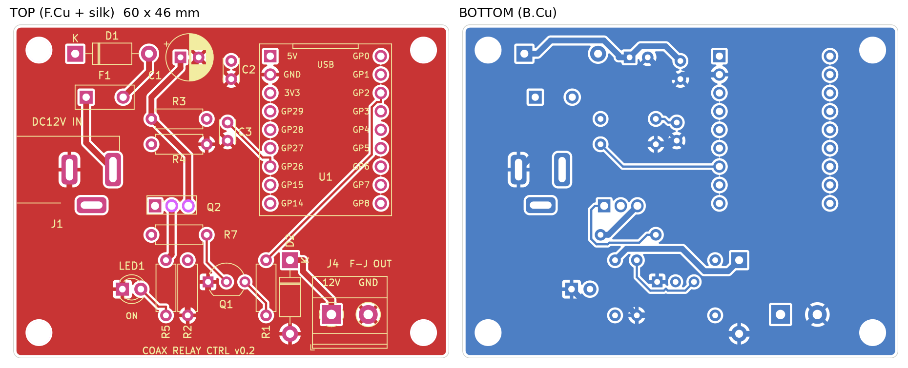
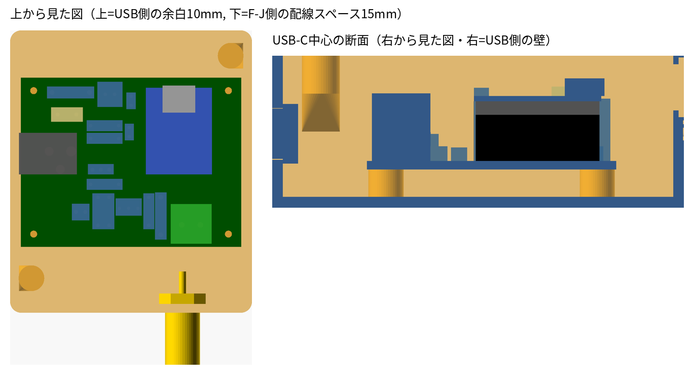

# coax-relay-switch

PCのブラウザ（Chrome / Edge）から、USB接続した **RP2040-Zero** を介して **12V同軸リレー** を切り替える制御基板です。
実家に置いたアンテナ切り替え器を、リモートデスクトップ経由で操作する用途で作っています（HF用）。

```
PC (Chrome)  ──USB(Web Serial)──  RP2040-Zero  ──GP2──▶  12Vハイサイドスイッチ  ──▶  Fコネクタ  ──▶  同軸リレー
                                       ▲
                                       └─GP26(ADC)── 12V電圧監視
```

- 操作ページ: https://jj1iyu.github.io/coax-relay-switch/ （GitHub Pages。Chrome / Edge を単独のタブで開く）
- リレー非通電 = **ANT1**、通電 = **ANT2**。起動・リセット・USB断のときは必ず ANT1

| 内容 | 場所 |
|---|---|
| ファームウェア（Arduino / Arduino-Pico） | [`firmware/coax_relay_ctrl/`](firmware/coax_relay_ctrl/) |
| 操作ページ（Web Serial） | [`docs/index.html`](docs/index.html) |
| 回路図・基板（KiCad、JLCPCB用ガーバー） | [`hardware/`](hardware/) |
| 3Dプリント用ケース（OpenSCAD / STL） | [`case/`](case/) |



## 回路の概要（rev0.2）

回路図: [`hardware/schematic.pdf`](hardware/schematic.pdf)

1. **電源入力** — DCジャック J1（MJ-179PH, センター＋）→ ポリスイッチ F1（MF-R050, 0.5A）→ 1N5819 D1（逆接保護）→ +12V。C1 100µF / C2 0.1µF。
2. **12V監視** — R3 47k / R4 10k で約1/5.7に分圧し GP26(ADC0) で読む。C3 0.1µF。
3. **マイコン** — RP2040-Zero を 1×9 ピンソケット2本に挿す。PCの USB から給電。基板の12V系とは GND のみ共通。
4. **12V出力スイッチ（ハイサイド）** — GP2=H → R1 1k → Q1 2SC1815 ON → Q2（Pch MOSFET IRFU9024N）のゲートを GND へ → Q2 ON → OUT=12V。
   GP2=L・起動前・リセット中は R2 10k が Q1 を、R7 10k が Q2 を OFF に保つ。
5. **出力** — 端子台 J4 → ケースの F-J（中心=12V、外側=GND）→ 同軸リレー。D2（1N5819）でコイルの逆起電力を吸収、LED1（R5 4.7k）は出力中に点灯。

Fコネクタはシールドが常に GND なので、中心導体（12V 側）を切り替えるハイサイド方式にしています。

### 部品（主なもの・秋月電子）

| 記号 | 部品 |
|---|---|
| U1 | Waveshare RP2040-Zero（1×9 ピンソケット ×2 に挿す） |
| J1 | 2.1mm DCジャック MJ-179PH |
| F1 | リセッタブルヒューズ MF-R050 |
| D1, D2 | 1N5819（D2 は 1N4148 でも可） |
| Q1 / Q2 | 2SC1815 / IRFU9024N |
| R1 / R2,R4,R7 / R3 / R5 | 1k / 10k / 47k / 4.7k（1/4W） |
| C1 / C2,C3 | 100µF 25V以上 / 0.1µF |
| J4 | ターミナルブロック 2P 5.08mm |
| — | F-J シャーシ用（ケースに取付）、12V ACアダプター |

## ファームウェア

- Arduino IDE ＋ [Arduino-Pico](https://github.com/earlephilhower/arduino-pico)（ボード: *Waveshare RP2040 Zero*）。ESP32 でもピン定義を切り替えて動く。
- 版は `FW_VERSION`（`firmware/coax_relay_ctrl/coax_relay_ctrl.ino` の先頭）。変更したら必ず上げる。
- **自動ビルド**: `firmware/` を変更して push すると GitHub Actions がビルドし、`docs/firmware/coax_relay_ctrl.uf2` と `version.json` を更新する。操作ページはこれを見て「更新あり」を出す。
- 初回（v0.2 以前からの更新）だけは、BOOT を押しながら RESET（または USB 挿入）で RPI-RP2 ドライブを出して書き込む。

シリアルコマンド（115200bps、行末 LF、大文字小文字は区別しない）:

| コマンド | 動作 | 応答 |
|---|---|---|
| `ON` / `OFF` | 出力 ON（ANT2）/ OFF（ANT1） | `STATE ON VIN 12.10 UP 35` |
| `?` | 状態の問い合わせ | `STATE ON/OFF VIN xx.xx UP n` |
| `VER` | 版と校正値 | `VER 0.3.0 CAL 1.0245` |
| `CAL 12.12` | テスターで測った 12V 入力の実測値で校正（フラッシュに保存） | `CAL OK 1.0245` |
| `CAL RESET` | 校正値を 1.0 に戻す | `CAL OK 1.0000` |
| `BOOTSEL` | 書き込みモード（RPI-RP2 ドライブ）で再起動。BOOT ボタン不要 | `BOOTSEL` |

`UP` は起動からの秒数。起動時に `BOOT 0.3.0` を送る。制御文字は無視する。

## 操作ページ

- GitHub Pages（上記URL）か、`docs/` で `python -m http.server` を実行して `http://localhost:8000/` を Chrome / Edge で開く。
- **単独のタブで開くこと。** 他のページへの埋め込み表示（プレビュー等）では `permissions policy` で Web Serial が使えない。
- 「接続」で RP2040-Zero の COM ポートを選ぶ。一度許可したポートには次回から自動接続し、USB が抜けて再び現れたときも自動で再接続する。
- COM ポートは同時に1つのソフトしか開けない（zLog・wfview・シリアルモニタと競合させない）。

### 保守（ページ下部の「保守」欄）

- **版の確認**: 接続するとマイコンの版と、公開中の最新版を表示。新しい版があれば「更新あり」。
- **ファームウェア更新（リモートデスクトップ越しでも可）**:
  1. 「① 書き込みモードにする」→ 最新の .uf2 を取得し、マイコンを RPI-RP2 ドライブとして再起動（出力は OFF）
  2. 「② RPI-RP2 を選んで書き込む」→ ブラウザのフォルダ選択で RPI-RP2 ドライブを選ぶと .uf2 を書き込む
  3. マイコンが再起動し、ページが自動で再接続して新しい版を表示
  - ②でドライブを選べない場合は、「.uf2 をダウンロード」してエクスプローラーで RPI-RP2 にコピーする。
- **電圧の校正**: テスターで測った 12V 入力の値を入れて「校正」。校正値はマイコンに保存され、書き込み直しても消えない。

## 動作確認チェックリスト

| 確認 | 操作 | 期待する結果 |
|---|---|---|
| 接続 | 「接続」→ COM ポート | 「接続中」、2秒ごとに電圧表示が更新 |
| ANT2 / ANT1 | ボタン | LED 点灯・OUT≈12V / LED 消灯・OUT 0V |
| 電圧表示 | 12V を入れる / 抜く | 実測とほぼ同じ / 0V付近で赤表示 |
| リセット | RP2040-Zero の RESET | USB が一度切れ、自動再接続後「マイコン再起動を検出（ANT1）」 |
| 校正 | 保守欄でテスターの実測値を入れて「校正」 | 電圧表示が実測値と一致し、再起動後も保たれる |
| 更新 | 保守欄の ①→② | 再起動後に自動再接続し、マイコンの版が最新版と一致 |
| 起動時の出力 | ANT2 のまま USB を挿し直す | 挿した瞬間も LED は点かず OUT 0V |

## 基板（hardware/）

- KiCad プロジェクト（KiCad 7 形式。KiCad 8〜10 で開ける）。60 × 46mm、2層、M3 取付穴 4隅。
- JLCPCB にはガーバー zip（`hardware/coax_relay_gerber_JLCPCB.zip`）をそのままアップロード（2層・1.6mm）。
- `hardware/scripts/` は回路図・基板を生成したスクリプト（参考。パスは作成環境のもの）。
- 発注前に実物で確認: RP2040-Zero のピン配置（左列 5V/GND/3V3/GP29…、右列 GP0…GP8）、MJ-179PH の穴位置（1:1 印刷で当てる）。

## ケース（case/）

- `coax_relay_case_body.stl` / `coax_relay_case_lid.stl` をそのまま印刷（PLA / PETG）。本体は開口を上、フタは表面を下にすれば**サポート不要**。
  - 45°を超えるオーバーハングは、穴（DCジャック φ10・F-J φ9.8）の上辺の短いブリッジと刻印文字だけ。USB開口は壁の上端まで切り欠いてあり、上はフタで塞ぐ。
  - フタ固定ボスの下面は約45°の斜面。
- 外形 約 65.8 × 76.8 × 30mm。基板の手前（F-J 側）に 15mm の配線スペース、奥（USB 側）に 10mm の余白。
- ネジ: 基板 M3×6 タッピング ×4、フタ M3×8 タッピング ×2。F-J は付属ナットで固定し、GND は M10 丸端子をナットに挟んで J4 へ。
- 寸法は `coax_relay_case.scad` の先頭のパラメータで調整（`usb_z`, `fj_d`, `fj_flat`, `front_margin`, `back_margin` など）。
- `overlay.scad` は KiCad の部品配置をケースに重ねて干渉を確認するためのファイル。


